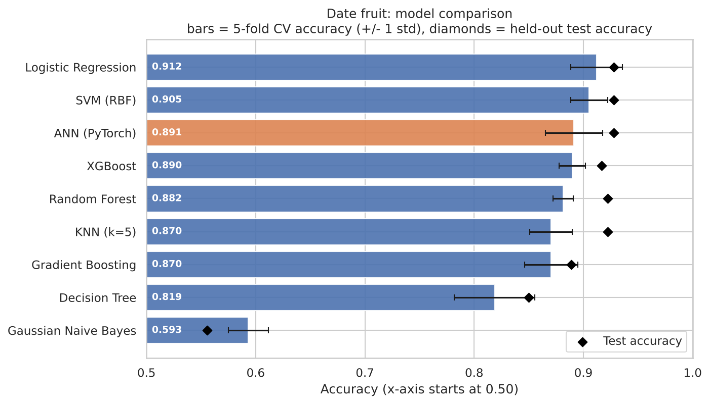
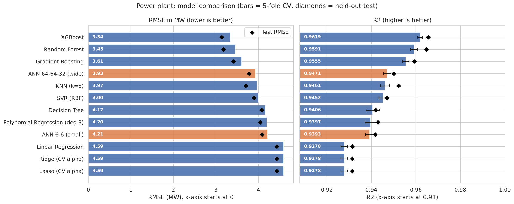

# Does a Neural Network Actually Beat Classical ML? ANN vs 8 to 11 Algorithms

I'm a fourth-year AI and Data Science student learning deep learning. I had built ANNs in PyTorch for two problems, and instead of just reporting one accuracy number, I wanted to know a simple thing: **is the neural network actually the best choice, or would a simpler algorithm do the job?**

So I took both problems and compared my ANN against a wide range of classical machine learning algorithms, using the same evaluation setup for every model.

## The two problems

| | Date fruit classification | Power plant regression |
|---|---|---|
| **Task** | Identify the variety of a date fruit (7 classes) | Predict hourly energy output in MW |
| **Data** | 898 samples, 34 features | 9,568 samples, 4 features |
| **Models compared** | 9 | 12 |
| **Notebook** | [`01_date_fruit_classification.ipynb`](notebooks/01_date_fruit_classification.ipynb) | [`02_power_plant_regression.ipynb`](notebooks/02_power_plant_regression.ipynb) |

## What I found

1. **Date fruit: the ANN did not win.** Logistic Regression came first, but SVM, my ANN and XGBoost are within the noise of each other. A plain linear model matching a neural network tells me the classes are almost linearly separable, and that 898 samples is not much for a neural network to learn from.
2. **Power plant: XGBoost won clearly.** RMSE of 3.34 MW against 3.93 MW for my best ANN and 4.59 MW for linear regression. The ANN beat the linear models but lost to the tree ensembles, which is common on small tabular data.
3. **One ANN run is not a result.** Retraining the same classification ANN with 5 different random seeds gave test accuracy anywhere between 88.9% and 95.0%.
4. **Network size matters.** My first, tiny `4-6-6-1` regression network performed about like a polynomial regression. A wider `4-64-64-32-1` network improved RMSE by about 0.3 MW.
5. **The hard classes are DEGLET and SOGAY** (F1 around 0.79 to 0.81). The other five varieties reach F1 of 0.95 or higher.
6. **On the power plant data, ambient temperature drives almost everything.** Shuffling it raises the error by 17.4 MW, versus 3.3 MW for the next feature.

## Results

### Date fruit classification

Models are ranked by 5-fold cross-validation on the training set. The test column is a single score on a held-out 20% (180 samples), so treat it as noisy: each sample is worth about 0.56 percentage points.

| Rank | Model | CV accuracy (mean ± std) | CV macro-F1 | Test accuracy |
|---|---|---|---|---|
| 1 | Logistic Regression | 91.2% ± 2.4 | 0.892 | 92.8% |
| 2 | SVM (RBF) | 90.5% ± 1.7 | 0.876 | 92.8% |
| 3 | ANN (PyTorch) | 89.1% ± 2.6 | 0.851 | 92.8% |
| 4 | XGBoost | 89.0% ± 1.2 | 0.855 | 91.7% |
| 5 | Random Forest | 88.2% ± 0.9 | 0.838 | 92.2% |
| 6 | KNN (k=5) | 87.1% ± 2.0 | 0.824 | 92.2% |
| 7 | Gradient Boosting | 87.0% ± 2.4 | 0.827 | 88.9% |
| 8 | Decision Tree | 81.9% ± 3.7 | 0.754 | 85.0% |
| 9 | Gaussian Naive Bayes | 59.3% ± 1.8 | 0.483 | 55.6% |



### Power plant regression

| Rank | Model | CV R² | CV RMSE (MW) | CV MAE (MW) | Test R² | Test RMSE (MW) |
|---|---|---|---|---|---|---|
| 1 | XGBoost | 0.9619 | 3.34 | 2.41 | 0.9656 | 3.14 |
| 2 | Random Forest | 0.9591 | 3.45 | 2.47 | 0.9648 | 3.17 |
| 3 | Gradient Boosting | 0.9555 | 3.61 | 2.69 | 0.9593 | 3.41 |
| 4 | ANN 64-64-32 (wide) | 0.9471 | 3.93 | 2.96 | 0.9501 | 3.78 |
| 5 | KNN (k=5) | 0.9461 | 3.97 | 2.89 | 0.9522 | 3.70 |
| 6 | SVR (RBF) | 0.9452 | 4.00 | 2.98 | 0.9470 | 3.90 |
| 7 | Decision Tree | 0.9406 | 4.17 | 3.07 | 0.9419 | 4.08 |
| 8 | Polynomial Regression (deg 3) | 0.9397 | 4.20 | 3.26 | 0.9430 | 4.04 |
| 9 | ANN 6-6 (small) | 0.9393 | 4.21 | 3.28 | 0.9418 | 4.08 |
| 10 | Linear Regression | 0.9278 | 4.59 | 3.65 | 0.9315 | 4.43 |
| 11 | Ridge (CV alpha) | 0.9278 | 4.59 | 3.65 | 0.9315 | 4.43 |
| 12 | Lasso (CV alpha) | 0.9278 | 4.59 | 3.65 | 0.9315 | 4.43 |



More plots (confusion matrices, predicted vs actual, residuals, training curves, feature importance) are in [`results/figures`](results/figures) and inside the notebooks.

## How I evaluated

- **Held-out test set (20%)**, used once at the end.
- **5-fold cross-validation** on the training set to rank the models. A single train/test split is too noisy to compare models fairly, especially with 898 samples.
- **No data leakage:** feature scaling sits inside each scikit-learn `Pipeline`, so it is fit on training folds only.
- **The ANN gets the same treatment as every other model.** It is wrapped in a scikit-learn-compatible class, uses a separate validation split for early stopping, and never sees the test data.
- **Classification:** stratified splits, macro-F1 (the classes are imbalanced), confusion matrices.
- **Regression:** RMSE and MAE in megawatts, residual plots, permutation feature importance.

## Limitations

- None of the models were hyperparameter-tuned beyond sensible defaults. Tuning could change the ranking, especially among the top models.
- The classification test set is small (180 samples), so small differences between models are noise.
- The ANN trains on 85% of each training fold because the other 15% is used for early stopping, so it has slightly less data than the other models.
- The power plant data has 41 duplicate rows, which I kept.

## How this project was built

I want to be upfront about this.

- The **original ANN notebooks are mine.** I wrote them while learning PyTorch, and they are in [`original_notebooks/`](original_notebooks), unchanged.
- The **comparison notebooks were built with AI assistance (Claude).** I used it to structure the experiment, write the multi-model comparison code, and review my original work, which is how I found problems in it (for example, using the test set to pick the best checkpoint and not scaling the regression target).
- I then ran the notebooks, read through the code, and am rebuilding the key parts from scratch to make sure I can write and explain them myself.

## Repository structure

```
.
├── README.md
├── requirements.txt
├── data/                    # the two CSV datasets
├── notebooks/
│   ├── 01_date_fruit_classification.ipynb
│   └── 02_power_plant_regression.ipynb
├── original_notebooks/      # my first ANN versions, unchanged
└── results/                 # result tables (CSV) and figures (PNG)
```

## Run it yourself

```bash
git clone <your-repo-url>
cd <your-repo-name>

python -m venv .venv
source .venv/bin/activate        # Windows: .venv\Scripts\activate
pip install -r requirements.txt

jupyter notebook notebooks/
```

Run the notebooks top to bottom. The classification notebook takes about 1 to 2 minutes and the regression notebook about 4 to 5 minutes on a laptop CPU.

## Datasets

- **Date Fruit Dataset:** 898 date fruit samples with 34 shape, colour and texture features across 7 varieties (Koklu et al.).
- **Combined Cycle Power Plant:** hourly ambient readings and net energy output (UCI Machine Learning Repository).

Please check each dataset's original page for its license and citation details.


---
Built by **Mohammed Murtuza Ali** · [LinkedIn](<your-linkedin-url>) · [GitHub](<your-github-url>)
